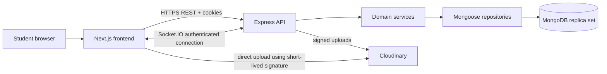

# Architecture

## Decision
Separate Next.js frontend and a single Express backend (REST + Socket.IO) is appropriate: clean separation, explicit API contracts and strong portfolio demonstration; extra deployment/CORS complexity is acceptable. Avoid microservices, Redis, queues, Kubernetes and Kafka in MVP.

## Responsibilities
- Next.js: responsive UI, forms, optimistic UI only where safe, authenticated navigation; never trusted for authorization.
- Express routes/controllers: authentication, validation, HTTP status, DTO mapping.
- Domain services: authorization, lifecycle transitions, concurrency rules, messaging/offer decisions.
- Repositories: atomic MongoDB updates and multi-document transactions; never expose raw persistence documents.
- Socket.IO: authenticate handshake with session, authorize conversation-room membership, emit persisted events only. REST remains authoritative for mutations in MVP; socket events are notifications.
- Cloudinary: store listing media; short-lived server-signed upload intent, validate ownership/limits, finalize asset association server-side, remove orphaned assets asynchronously/manual reconciliation.

## Authentication
Registration -> unverified user -> college verification -> verified student. Login sets Secure, HttpOnly, SameSite cookie; server validates session, verification and ownership/participant role on each request. For cross-origin deployment configure explicit CORS origin and CSRF protections. Socket handshake validates same session and room joins check participant membership. Revoked accounts lose access on next validation/reconnect; define session invalidation.

## Core flows
1. Listings: verified user -> validated REST request -> service authorization -> MongoDB -> response.
2. Chat: REST message creation -> save message -> commit -> emit `message.created` to authorized room; clients refetch on reconnect.
3. Offers: REST create/respond -> transactional history and current-state updates -> emit offer notification after commit.
4. Reservation: accept pending offer in MongoDB transaction with conditional listing `available -> reserved`; competing acceptance loses with `409`.
5. Handover: buyer and seller confirm independently; service completes transaction and marks listing sold atomically.

## Verification and audit boundaries
Verification is a configurable adapter selected before Stage 2: institution-controlled email challenge, restricted manual review, or institution SSO. `unverified/rejected -> pending -> verified/rejected`; privileged revocation may return verified to unverified. Reviewers access evidence only through authenticated admin APIs; credentials, tokens, evidence and decision notes are never included in public DTOs. Email eligibility, SSO claim mapping, reviewer roles, retention and revocation rules are unresolved college-specific policies.

Admin verification and moderation actions create append-only `audit_logs` records containing actor, target, action, outcome, timestamp, request ID and sanitized change metadata. Restrict audit reads to explicitly authorized administrators; do not log message bodies, secrets, raw student IDs or uploaded evidence. Where an admin action changes a MongoDB document, write its audit record in the same database transaction or fail the action. Failed authorization attempts are security logs, not falsely committed successful audit events.

Negotiation: one pending offer per conversation; the recipient may accept/reject/counter and proposer may withdraw. Countering atomically supersedes the previous pending offer with a new linked offer. Acceptance uses a MongoDB transaction across offer, transaction and listing, with compare-and-set and unique indexes; no Socket.IO event is emitted until commit. A disputed transaction retains the listing reservation; cancellation/expiry releases it atomically. Sockets only notify committed outcomes.

## Failure and operations
Consistent JSON error envelope with code/message/requestId, no stack traces in production. Validate all payloads, central exception handler, structured redacted logs. If socket delivery fails, persisted data remains and clients reconcile via REST. Separate environment files and databases for local/test/prod. HTTPS reverse proxy for frontend/API, Cloudinary credentials only on server, backups and restore drills before pilot. Replica-set-compatible MongoDB deployment is required for multi-document transactions; local dev may use a single-node replica set. Never assume standalone MongoDB supports these transactions.

## API boundaries
REST handles all persisted writes and paginated reads. Socket events are outbound `message.created`, `offer.created`, `offer.updated`, optionally `message.read`; optional client `conversation.join` is authorized and does not mutate business state. Payloads are documented in API specification extensions.
